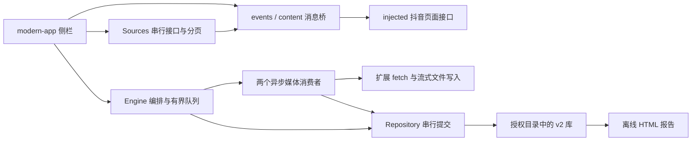

# 抖音备份技术实现规格 0.8.7

> 0.8.8 的列表与详情调度、失败收尾及暂停行为见 [实现变更](plugin-release-0.8.8.md)。


更新：2026-11-05。按 `plugin/manifest.json` 与源码核对；只描述现代扩展，后端独立工具和旧 `sidebar/app.js` 不属于这条运行链。产品语义见 [产品规格 v0.3](plugin-product-spec-v0.3.md)，模块概览见 [架构](architecture-design.md)。相对源码链接指向实际模块，不固定易失效的行号。

## 1. 运行链与职责



| 文件 | 主要职责 |
| --- | --- |
| [content.js](../plugin/src/content.js)、[content.css](../plugin/src/content.css) | 网页内 iframe、侧栏和悬浮位置管理 |
| [injected.js](../plugin/src/injected.js)、[events.js](../plugin/src/shared/events.js) | 页面登录态接口；按 requestId 关联消息、超时与 AbortSignal 清理 |
| [modern-app.js](../plugin/src/sidebar/modern-app.js)、[presentation.js](../plugin/src/sidebar/presentation.js) | 路由、选择持久化、状态映射、错误恢复提示、节流渲染 |
| [sources.js](../plugin/src/core/sources.js)、[pagination.js](../plugin/src/core/pagination.js) | 账号、列表、作品详情；游标检查、异常重读与终止判断 |
| [engine.js](../plugin/src/core/engine.js) | 库锁、生产消费、计数、逐作者屏障、暂停与一轮补下 |
| [media.js](../plugin/src/core/media.js)、[api.js](../plugin/src/shared/api.js) | 媒体段归一化、候选排序、质量门槛、分段提交及安全升级 |
| [retry.js](../plugin/src/core/retry.js)、[download.js](../plugin/src/shared/download.js) | 重试预算、origin 冷却、验证媒体响应、Range 与流式写入 |
| [repository.js](../plugin/src/archive/repository.js)、[fs.js](../plugin/src/archive/fs.js) | v2 状态事实源、日志/双头恢复、账号绑定、文件系统适配 |
| [layout.js](../plugin/src/archive/layout.js)、[naming.js](../plugin/src/archive/naming.js) | 分类布局、本地副本、文件名保留与冲突处理 |
| [report.js](../plugin/src/archive/report.js) | 构造报告模型、安全路径、离线筛选和 HTML 渲染 |
| [organize.js](../plugin/src/maintenance/organize.js)、[measure.js](../plugin/src/maintenance/measure.js) | 闲时整理与缺失大小统计；哈希计算使用 Worker |

这是异步 I/O 并发：没有给每个下载启动独立进程或 Worker。Worker 用于维护哈希，不负责页面 DOM、目录授权或下载调度。扩展 service worker 处理目录选择窗口等工作，不承诺标签页关闭后继续该下载任务。

## 2. 启动、账号和互斥

`folder-picker/app.js` 使用 `showDirectoryPicker({mode:"readwrite"})`，检查目录、打开 Repository、在库锁内初始化，然后通过浏览器存储记住句柄。非空且不可识别的目录报错；新空目录不增加业务二次确认。

现代库标识为 `data/.appdata/archive.json` 的 `schemaVersion:2`。`Repository.bind()` 校验 UID，历史归属未知时要求显式绑定。Engine 启动与每页扫描校验账号，发现切换暂停。下载、整理和报告以 `navigator.locks.request("douyin-archive-" + state.id, {ifAvailable:true})` 互斥；`maintenance.json` 同时阻止维护中的库被正常打开。

Web Locks 约束配合该锁的浏览器上下文。独立后端或外部离线脚本不自动受此锁保护，不能宣称插件和后端可同时写同一 v2 库。

## 3. 数据事实源和提交协议

逻辑状态主要字段：

| 字段 | 内容 |
| --- | --- |
| `works[id]` | 全库作品身份、complete、sources、文件路径、作者描述、命名、媒体布局与诊断 |
| `files[path]` | 路径、workId、partId、角色/类型、size、complete、质量与尝试记录 |
| `tasks[taskId]` | scope、账号、作者、items、cursor、sourceDone、sourceErrors、run、retryState、cooldowns、recovery |
| `followingSelection` | 已选作者的 uid/secUid/nickname 与 updatedAt |
| `owner` / `aliases` | 账号绑定与迁移后路径别名 |

物理记录：

```text
data/.appdata/
  archive.json
  v2/heads/a.json
  v2/heads/b.json
  v2/snapshots/<uuid>.json
  v2/journal/<seq>-<txId>.json
```

`Repository.commit(patch)` 经 Promise chain 串行执行：先写不可变事件，再写交替 head 槽，读回校验 head 后才更新内存。事件包含 seq、txId、parent 与 patch；head 包含 snapshot、tail、seq、revision。`seal/unseal` 用 JSON body 加 SHA-256 校验内容一致性，不能当成加密或访问认证。

加载时尝试按 revision 从新到旧的 head，验证快照和父链，逆序重放事件；较新链不可用可回退另一条有效链。两条均损坏则报错，不初始化为空库。`compact()` 写新快照后切换 head，不代表已经自动清理所有旧快照和日志。

提交失败会设置 `poisoned`，阻止后续正常提交；Engine 安全暂停，重新 load 成功后才解除。该协议降低部分写入破坏状态的风险，不能保证强制断电、设备故障、未提交内存事件零丢失。新库和旧库识别、账号错误也不能伪装为空记录。

旧 `download-index.json` / `download-state.json` 是导入兼容线索，不能反向覆盖 v2 事实源。报告、UI 计数和旧 IndexedDB 均不能作为现代任务是否完成的最终状态。

## 4. 正常下载流水线

`modern-app.start()` 正常调用 Engine 时不传 `retryOnly` 或 `continueFollowing`。新任务从列表开头建立 cursor，读取已有备份索引；内部保留的旧恢复/失败重试接口不代表当前产品入口。

1. 获得库锁、load、恢复相关限流信息、读取 profile 并 bind。
2. 创建当前 task 与 run；生产者分页读取并按 ID 去重，已完成且无升级/布局需求的记录记为已有。
3. 队列交给两个 `consume()` 异步消费者；生产者不等待整库扫描结束。
4. 消费者补布局或调用媒体执行器，成功后更新作品和本轮计数，失败保留原因。
5. 首轮结束后满足条件则跑一次 recovery，再计算最终状态并 compact。

默认 capacity=64；生产者按 queue+active 背压，发现预留 `min(18,max(0,capacity-2))`，避免整页追加无界增长。两个消费者不是硬件线程，也不代表任何网络环境下速度翻倍。

关注按作者索引推进。前一作者队列和 active 清空后再读下一作者；恢复失败时也使用作者屏障，防止两个作者同时传输。作者分页与作品分页不使用旧版 `.slice(0,100)` 的业务批次限制。

## 5. 接口调度与分页

页面消息以 `{source, requestId, type, payload}` 发送，响应按 requestId 匹配；`events.js` 在响应、超时或中止时清理 pending 与监听器。页面内桥接消息和扩展 runtime 消息不是同一条通道：

| 消息 | 路径/参数 |
| --- | --- |
| GET_SELF_PROFILE | 当前账号身份及可用统计 |
| FETCH_LIKED_PAGE | secUid、maxCursor、minCursor、count=18 |
| FETCH_BOOKMARKED_PAGE | cursor、count=10；可复用同账号 15 秒内探测过的首个收藏页 |
| FETCH_FOLLOWING_PAGE | userId、secUid、offset、maxTime、minTime、count=20；20 是单页请求量 |
| FETCH_AUTHOR_AWEME_PAGE | 所选作者 secUid、maxCursor、count=18 |
| FETCH_AWEME_DETAIL | awemeId；补下刷新媒体地址 |
| OPEN_FOLDER_PICKER_TAB | 扩展 runtime 消息，由 background 打开授权窗口 |
| SET_SIDEBAR_COLLAPSED / FLOATING_DRAG / CLOSE_SIDEBAR | 侧栏向 content 通知显示、拖动和隐藏操作 |

`Sources.call()` 使用 Promise chain 串行化页面接口；默认间隔：喜欢 5000ms、收藏 3000ms、关注 1200ms、作品详情 400ms。它们是接口调度间隔，不是媒体下载之间必须睡眠的时间。

页面桥接请求在该调用路径使用 60000ms 超时，并接收 AbortSignal。外层媒体详情刷新另设 2 秒中止预算；普通列表、profile 请求不能概括为都在 2 秒内结束。分页异常恢复延迟为 1200/3000ms，最多连续空页预算为 12；这些与媒体短重试分别处理。

[分页模块](../plugin/src/core/pagination.js) 检查结构、重复 cursor、异常末页及空页；Engine 同时保存 seenCursors 和分页诊断。可信终止使用经过验证的接口语义与必要确认，不能统一要求末页 cursor 必须为 0，也不能把任意空页当末页。规范末页（明确无下一页且零游标）可直接结束；非标准明确末页会再次确认，连续两次明确末页才确认结束。关注名单将响应 min_time 作为继续向较早关注翻页的 maxTime 边界，避免错误复用当前页 max_time；缺失时有 offset/响应字段兼容逻辑，按 UID 去重。异常退出保留 sourceErrors/sourceDone 状态，不把截断列表标成完整备份。

## 6. 媒体选择、响应预算和续传

`normalizeAweme()` 将视频、图文、live photo、明确多视频映射为有序 mediaParts；不能把候选编码变体当作不同视频片段。所有必需内容段完成后作品才 complete，封面是独立可选媒体角色，封面失败保留诊断，不推翻已完成内容。

`rankedCandidates()` 按分辨率面积、码率、帧率、大小排序并去重 URL；“最高”指接口当次可用最高候选，不保证平台原始母版。升级判定先比较分辨率，同面积下比较已知帧率，或同编码下已知码率；不凭文件更大推断更清晰。

媒体部件每次处理最多发起两次请求，共享 deadline=起点+2000ms。响应头与首段数据等待使用剩余预算，普通临时错误/403 退避基准 100ms，加少量抖动，最多一次。补下需要刷新详情时，详情等待与第一段媒体响应共享起始 deadline。成功持续传输允许超过 2 秒，但连续无数据 2000ms 会中止尝试。多片段各自有预算；磁盘调用不能由网络 AbortController 保证 2 秒硬终止。

`downloadVerifiedMedia()` 以扩展 fetch 直接获取媒体、校验 HTTP、MIME、长度与 Range。流式写文件，不把整部视频先读进内存。`<media>.resume.json` 记录表示身份，已有字节仅在身份匹配时发送 Range；服务端返回完整 200 时从头写，不把旧字节与新版本拼接。206 必须与本地偏移及总长度一致。媒体成功后移除 resume 标记，未完成文件不算完成。

`representationKey()` 清理已识别签名时效参数，身份仍包含作品、部件、编码尺寸等，不能因同一个短文件名就盲目续传。只验证响应类型/大小与表示信息，不等同对每个下载执行内容哈希或做解码认证。

## 7. 429 与自动补下一轮

`RetryCoordinator` 区分局部等待、媒体 origin gate、页面接口共享冷却：

- 403/临时网络错误只等待本操作，不更新全局阻塞时钟。
- 媒体传入 `rateKey=new URL(url).origin`；429 冷却存于 `gates` 与任务 `cooldowns`，尊重 Retry-After。无该头时有 15 秒基准退避；超过媒体 deadline 时返回 deferToSweep，让出槽位。
- 页面接口不带 rateKey，使用共享 retryState；重试耗尽的列表 429 可使任务暂停。

主列表 `sourceDone`、首轮消费者全部返回、非 retryOnly 且未中止时，收集 failed 且可重试的项目。补下先复核账号，不带旧 raw，因此会重新取作品详情；有冷却的项由生产者等待到可用，不让消费者长期占位。补下使用同一个 run，不增加 checked；入队时扣除此前 failed，成功改为 saved/upgraded/existing，仍失败再计为失败。`task.recovery` 保存 round=1、total、status、recovered、remaining 等。

每次正常下载最多自动补一轮；补下后新产生或仍然存在的失败不会再次无限补下。列表未完整读取、手动暂停、写盘等阻断错误不触发该自动补轮。

## 8. 画质升级与分类布局

`qualityUpgradeParts()` 先按已保存 outcome 筛选：best 跳过，只有 degraded/fallback 可能升级，unknown 不盲目重下。更好候选成立后，升级写入 `.appdata/staging`；内容成功并切换持久引用后再清理旧路径。升级失败保留原完整媒体和诊断，不增加新增作品数。

`layout.js` 将喜欢/收藏与关注分别映射到 `data/喜欢`、`data/收藏`、`data/我的关注/作者名_UID`，再分封面/视频/图片。`ensureSourceLayout()` 按部件补齐对应来源副本；跨来源复用本地文件，不重复拉 CDN。作品身份为全库 ID，文件身份为路径；同 ID 的多个来源副本仍各占真实磁盘空间。

`naming.js` 保留 `{version:1,title,author,token}`。NFC 清理、字素和 UTF-8 限长防止截断表情及过长文件名；后 8 位 token 冲突时每次加 4 位，直到完整 ID。冲突登记还考虑规范化大小写和关注作者维度，不能仅信任文件名。详细可见 [0.8.4](plugin-release-0.8.4.md)。

## 9. UI、作者选择与报告

`presentation.js` 统一首页、任务页、页脚、悬浮提示的 taskStage；列表冷却但媒体仍有数据时优先显示下载中。taskProblem 读取当前错误或已保存 sourceErrors，给账号、文件夹、磁盘、锁、分页和限流解释，普通手动暂停不生成假错误。

普通状态渲染合并约 180ms；字节进度约 100ms 只更新传输 DOM、状态文字及环，不整页重绘。作者选择变更约 400ms 合并后在库锁内提交 followingSelection；启动前等保存完成。搜索与结果全选共享 matchesAuthor；完整名单缺失项不能静默从选择中丢弃，显式处理后才启动。

报告暂停/结束后约 600ms 调度，空闲时才生成；缺失大小统计约 1200ms 后调度并可取消，让位于下载。时间是代码调度参数，不是端到端性能指标。

`buildReportModel()` 从 v2 状态派生来源数、去重数、失败、画质与作者分组，旧本地元数据仅用于补详情。HTML 包含生成时数据，无外部服务依赖；首页不绘制全库作品 DOM，进入分类后每页 50 条。搜索/排序仍在浏览器内存数据上执行，并非数据库服务端分页。reset 保留分类/作者；媒体链接优先当前来源且避开封面、未完成文件。数据插入 script 转义 `<` 等，文本/属性转义，媒体路径只允许安全 data/ 相对路径，CSV 避免公式前缀注入。

## 10. 兼容、维护和已知边界

现代库、旧 state/index 可识别导入，但旧记录可能只有完成索引，缺路径、大小、作者或最高画质证据。不能把这种记录补成虚构详情。外部改名/删除不自动等于记录已同步；需要闲时整理核对。

维护使用相同库锁，哈希 Worker 处理内容比较，命名/分类迁移同步更新引用和别名；特殊 Unicode 路径匹配只在唯一且可核对时使用回退。维护不是下载前置全盘扫描。独立脚本操作前应暂停下载并关闭写入方，不将浏览器库锁当作跨进程万能锁。

后端是独立诊断/自动化工具，不能仅因共用解析代码就承诺可直接安全写回当前 v2 journal。旧一次性流程、私信动作和旧 IndexedDB 代码保留不代表现代侧栏暴露这些功能。API 可见性、下架、隐私及平台限流均可能使结果不完整；“本轮完成”不等于平台全部不可见内容也已导出。

代码级、浏览器合成和真实数据验收的边界见 [发布手册](test-release-runbook.md)。没有本轮实测就不填写 CPU、内存、吞吐或 p95 数值。
