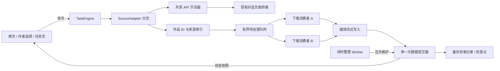

# 抖音备份插件设计方案 v1

> 历史文档：本文保留当时讨论/实现记录，已由 [当前 0.8.7 对应文档](plugin-product-spec-v0.3.md) 替代。正文中的“当前”“尚未实施”、旧数量与恢复规则不代表现版本。


日期：2026-10-27。现状基线：0.6.2 / 3533ac2。产品依据：[Spec v0.2](plugin-product-spec-v0.2.md)。

状态：设计已进入 0.7.0 本地试用实施。本文保留完整目标设计，当前交付范围和验证证据见 [0.7.0 试用说明](plugin-release-0.7.0.md)；未列入交付的目标不表示已经完成。

## 1. 设计决策

| 决策 | 采用方案 | 原因 |
| --- | --- | --- |
| 下载入口 | 首页四个主要操作，点击来源即执行 | 保持路径短，不要求预扫描确认 |
| 下载准备 | 分页发现与媒体下载交叠 | 尽早开始传输，避免先读完整列表 |
| 初始并发 | 两个异步作品消费者，全任务最多两条媒体传输 | 可先实测，不把并发数直接等同于提速倍数 |
| 去重 | 下载时查 ID / 在途锁；闲时比对文件内容 | 避免重复传输，又不把全盘整理放在关键路径 |
| 数据权威 | 备份目录的 v2 记录；浏览器 IndexedDB 为可重建缓存 | 换浏览器后仍可继续使用历史库 |
| 数量 | 全库唯一作品数、本轮任务状态、文件大小分别计算 | 不再混用来源累计数、平台数与任务量 |
| 执行上下文 | 第一阶段保留扩展 iframe，任务引擎独立于页面渲染 | 复用当前目录句柄和页面桥接，减少系统改动 |
| 维护 | 手动“整理备份”，与下载互斥 | 避免抢占下载资源与误删在途文件 |

## 2. 页面与交互

只保留三个主要页面：Home、FollowingPicker、Task。维护、设置和详细记录为次级页面/抽屉，喜欢转收藏及私信工具不进入下载主流程。

### 2.1 首页 Home

顺序固定：产品/账号 → 文件夹 → 库数量 → 三个下载入口。侧栏建议宽 380–420px，窄屏宽度不超过可用区域。白色表面、浅灰分隔、近黑正文、少量系统蓝；常规文字 14px，标题 17px，主数量 28–32px，避免大面积装饰卡片。

```text
抖音备份                           更多
当前账号

保存到
我的抖音备份                 更换文件夹

已备份
11,352 条作品
已完成媒体约 128.4 GB
记录更新于 14:32

下载喜欢                            →
下载收藏                            →
下载关注列表                        →
```

- 未选文件夹：数量区显示空态，“选择文件夹”为主操作；下载入口禁用。
- 库就绪：来源按钮本身为入口，无第二个“开始”按钮。
- 正在下载：原来源按钮说明“正在下载，点击查看”；其他两个入口不可启动，说明“先暂停当前任务”。
- 已暂停：原来源按钮说明“有暂停任务，点击继续”；其他来源可以新建独立任务，保留原任务，不能覆盖；同来源的暂停任务优先恢复。
- 文件夹读取失败：保留已知库名与上一份记录，明确显示失败/更新时间；不可用时禁用下载，不能显示为 0。
- 更换目录：先安全暂停当前任务，再允许打开选择器；取消选择不丢原库。

菜单：“整理备份”“库详情”“下载设置”“更多工具”。菜单不显示另一组下载入口。

### 2.2 关注作者选择 FollowingPicker

头部“返回 / 选择关注作者”，搜索框、已选人数、作者列表、底部“下载所选 N 位作者”。无选中时主按钮禁用。

- 按稳定作者 ID 保存选择，不能按昵称保存。
- 缓存作者列表可先显示，后台刷新；搜索说明覆盖已加载作者，完整搜索需要继续读取列表，不能伪称已搜索全部。
- 作者列表分页持续加载；不把第一页或默认批次当全部关注。
- 再次进入恢复勾选，开始前校验选择仍有效；作者失效就地解释，至少一位有效时才能执行。
- 点击底部按钮直接进入 Task，不出现确认清单。
- 一个关注任务固定一组作者。恢复时使用原作者集合，修改选择生成另一个 taskId，不覆盖旧任务。

### 2.3 任务 Task

```text
‹ 返回首页                         下载喜欢
保存到：我的抖音备份

本次已保存
238 条
已存在 76 条 · 失败 2 条
已发现待处理 14 条，其中下载中 2 条

当前下载（最多两行）
作者 · 描述          视频第 1 / 2 段  46%
作者 · 描述          图片第 3 / 8 张
合计传输 8.2 MB/s

已读取 330 条，仍在读取列表
抖音显示喜欢 12,345 条，仅供参考

暂停                               任务明细
```

- 同时下载两条时分别显示当前作品，不把两条连接错误地合为一个“当前文件进度”。
- 返回首页、收起或关闭面板仅隐藏/切换视图，任务继续。真正暂停由任务按钮执行。
- 不在列表未读完时显示总进度环或全局百分比。文件已知长度可显示自己的进度条。
- 作者任务补充“作者 2 / 8 · 当前作者”，作品量独立展示。
- 任务明细按失败、待处理等状态查看；主界面不放游标、作品 ID、请求报文和性能日志。
- 终态沿用此页面，显示结果和“重试失败项 / 返回首页”，避免再建一个重复结果仪表盘。

### 2.4 状态对应操作

| 状态 | 主文案 | 可执行动作 |
| --- | --- | --- |
| starting | 正在连接备份库 | 暂停 |
| running | 正在下载 / 正在读取下一页 | 暂停 |
| pausing | 正在暂停并保存 | 禁止重复提交 |
| paused | 已暂停，进度已保存 | 继续 |
| blocked | 需要重新登录 / 授权 / 处理磁盘问题 | 对应修复后继续 |
| finalizing | 正在保存结果 | 等待；不提前显示完成 |
| completed | 本次下载完成 | 返回首页 |
| partial | 本次处理结束，部分未完成 | 重试 / 查看原因 |

## 3. 数量模型与更新规则

### 3.1 库摘要 LibrarySummary

```ts
type LibrarySummary = {
  libraryId: string;
  accountUid: string;
  uniqueCompletedWorks: number;
  completedMediaBytes: number | null;
  sizeCoverage: 'complete' | 'partial' | 'unknown';
  sourceRelations: { liked: number; bookmarked: number; following: number };
  committedSeq: number;
  updatedAt: string;
  verifiedAt: string | null;
};
```

全库唯一作品数是拥有至少一个完整媒体版本的作品集合大小，不是来源计数之和。来源数量统计已完成作品的关联，明确允许重叠。

媒体大小按库内规范化相对文件路径记录，一条路径只计一次，不同副本路径分别计数；这是已完成媒体文件的逻辑大小，不是操作系统磁盘分配量。临时文件和未完成媒体不混入此指标。

历史大小未覆盖全库时显示“媒体大小待统计”，详细页可显示“已记录部分 X GB”。不能将已知部分冒充整个库的大小。

### 3.2 任务计数

每个任务的同一作品只有一条 TaskItem。状态互斥：

```text
C 已读取 = S 本次成功 + E 已存在 + F 失败 + X 不支持 + P 待处理
P = preparing + queued + downloading + retry_wait + committing
```

下载完成、元数据尚未提交时仍属于 committing，不提前计成功。重试 F→P，最终成功 P→S，C 不增加。恢复原任务保留 S，不因为浏览器重启归零；“本次”指该 taskId 的整个生命周期。

网络回调不能直接修改计数。统一 reducer 按 `{taskId, awemeId, itemVersion, eventId}` 转换状态，忽略重复事件和旧版本事件；摘要与任务数由相同已提交状态派生。

| 事件 | 库唯一数量 | 文件大小 | 本次数量 |
| --- | --- | --- | --- |
| 命中已有完整作品并增加来源 | 不变 | 不变 | E+1 |
| 首次完成新作品 | +1 | 增加新增文件字节 | P→S |
| 补齐原本未完整的作品 | 首次达到完整时 +1 | 计入最终完成版本文件 | P→S |
| 同作品新增物理副本 | 不变 | 增加副本字节 | 依任务状态转换，不重复增加 C |
| 重试一个失败项 | 不变 | 未提交完成不计入 | F→P |
| 整理删除重复副本 | 通常不变 | 扣除已移除文件字节 | 不修改历史任务 S |

传输速度使用所有在途媒体响应体的 5 秒滑动窗口总字节；展示每秒更新一次。UI 数量最多每 250ms 合并渲染一次，紧急状态变化立即渲染。原型数字仅为示例，不能当实测数据。

## 4. 运行时架构



### 4.1 上下文选择

第一阶段任务引擎作为扩展 iframe 内的单例模块启动，路由和渲染只订阅它。`content.js` 中关闭侧栏从删除 iframe 改为隐藏，展开复用原实例；返回首页不销毁引擎。

`background.js` 只承担唤起界面、目录选择窗口等短操作，不迁移长任务进去。Chrome service worker 会被终止，进度必须放在可恢复记录里。

页刷新、标签关闭、扩展更新会终止承载上下文。恢复从最后已提交状态开始；不能依赖 unload 中完成全部写入。页面导航造成中断时，重新打开仍可从原来源入口继续。

### 4.2 模块拆分

| 目标模块 | 责任 |
| --- | --- |
| `sidebar/router.js`、`views/` | 三个主视图及维护/设置界面 |
| `sidebar/view-models.js` | 从快照生成文案，禁止直接读取全库或调下载 API |
| `core/task-engine.js` | start/pause/resume/retry/subscribe，单任务调度 |
| `core/task-reducer.js` | 状态转换、计数守恒、幂等事件 |
| `core/pipeline.js` | 有界队列、生产/消费、重试和结束条件 |
| `core/api-scheduler.js` | 平台 API 预算、端点节流与退避 |
| `sources/liked.js`、`bookmarked.js`、`following.js` | 统一分页协议，关注逐作者推进 |
| `archive/repository.js` | 库身份、作品/媒体/来源记录及快速索引 |
| `archive/writer.js`、`recovery.js` | 提交、日志、检查点与中断恢复 |
| `archive/legacy-adapter.js` | 读取 v1 历史数据，不重写旧媒体 |
| `maintenance/` | 本地核对、重复候选筛选、哈希与归并 |

复用 `shared/api.js` 的候选排序与媒体规范化，复用 `shared/download.js` 的流式写入和校验能力；修改为接收 signal/onBytes 等参数，不重写已有媒体格式规则。现有喜欢/收藏分页协议保留并补齐异常终点行为。

## 5. 分页、背压、并发和结束

### 5.1 统一协议

```ts
type SourcePage = {
  items: WorkCandidate[];
  nextCursor: unknown;
  terminal: 'more' | 'complete' | 'invalid';
  authorUid?: string;
};
// source.next({ checkpoint, signal }) -> Promise<SourcePage>
```

协议由每个来源解释实际游标和可信结束条件，不用一个通用 `!items.length` 认定全部完成。空页但仍有下一页、游标不前进、异常终点必须有覆盖测试。

作者任务先一个作者、逐页生产再换下一个，首个作者首批可下载作品即可开始传输。全部作者完整性单独记录；单作者失败可以继续其他作者，全局登录/限流阻塞则停止发起新请求。

### 5.2 调度参数

- 初始两个作品消费者；媒体信号量容量 2，图片、封面、多段视频共同计入，不产生隐式 2×N 并发。
- 初始队列容量 64，低水位 16；下载中和待提交项目也占待处理预算。请求下一页前预留该页最大候选容量，入队后归还未用槽位，避免一页返回导致超额。
- 仅保留小队列的候选信息，不预取全部媒体 Blob。大型历史记录按键查询，避免反复 `getAll(items)`。
- 平台 API 请求初始总并发 1，列表与详情共享预算；队列紧缺时准备必要详情优先，列表按端点节奏预取。
- 先保留现有喜欢最少 5 秒、收藏最少 3 秒的列表请求间隔；这是当前实现参数，不宣称平台官方配额。关注分页也保留节流。
- 不让两个消费者各自 sleep 后失控地倍增 API 频率。原逐作品随机等待迁移到统一调度器，根据真实错误率再调节。
- 有明确限流信号时降到一路并进入退避，必要时显示需用户处理；增加 Worker 不改变平台请求预算。

### 5.3 任务结束条件

```text
所有目标来源/作者结束
AND 无未提交分页
AND 无 queued/preparing/retry_wait/downloading/committing
AND 无在途媒体和桥接请求
AND 必要记录已提交
→ 根据失败与来源完整性决定 completed 或 partial
```

队列暂空不代表结束；遇到一页全是已有作品继续分页，不假设后面必无缺口。100 条不参与结束判断。平台总数不参与成功判定，只作参考。

## 6. 数据对象与存储

逻辑关系：一个 Work 对应多个 SourceRelation、多个 MediaVersion；一个 MediaVersion 对应多个必需 MediaPart；一个物理 MediaFile 可以被多个来源/记录复用。

| 对象 | 主键 | 关键内容 |
| --- | --- | --- |
| Library | libraryId | schemaVersion、账号、格式能力 |
| Work | awemeId（库内） | 描述、作者、类型、完整版本引用 |
| SourceRelation | source + ownerUid + awemeId | 本轮见到时间，历史关联保留 |
| MediaVersion | awemeId + variantId | 画质、必需分段集合、完整性 |
| MediaFile | 规范化相对路径 | 文件长度、状态、可选哈希 |
| Task | taskId | libraryId、账号、来源、固定作者集合、状态与分页检查点 |
| TaskItem | taskId + awemeId | 互斥状态、重试、错误、提交版本 |

路径不能包含远端任意目录跳转，文件名采用稳定 ID 和媒体段标识。新媒体使用 `data/媒体/<awemeId>/<variantId>/...`，旧版点赞/收藏/关注目录保持原路径，统一通过媒体记录引用。

### 6.1 v2 目录建议

```text
data/.appdata/
  archive.json                    # 库身份、schemaVersion=2
  v2/
    heads/a.json, b.json           # 带校验的提交头，交替更新
    journal/<seq>-<txId>.json      # 不可变增量提交
    snapshots/<generation>/       # 作品/媒体索引、任务快照、摘要
    maintenance/<operationId>/    # 整理操作日志与恢复信息
```

目录记录为权威；IndexedDB 按 libraryId 缓存且记录 committedSeq，可丢弃重建。不能让浏览器记录覆盖目录中更多的历史作品。

### 6.2 提交顺序

1. 文件写入关闭并完成必要校验，作品进入 committing。
2. 单一 writer 汇集完成、来源和队列变更，写不可变增量日志，包含 seq、txId、父序号及内容校验。
3. 日志成功后更新另一份提交头，引用有效快照和本段尾序号；读取验证后作为新的已提交版本。
4. 发布已提交快照；成功数量、唯一作品量、文件字节在此更新。
5. UI 渲染与浏览器缓存更新是派生操作，失败不能改变目录事实。

初始提交合并窗口建议不超过 250ms、待提交作品不超过 8；媒体槽位可以交给下一项，但 committing 占总待处理预算。不要为了合并数量让已写完但未保存记录无限堆积。

提交日志一旦写失败保留当前变更，阻止继续扩大写入队列，显示错误并允许重试。不存在多文件“天然原子写入”的假设；启动时选择引用链完整、校验通过的最新提交头，忽略/恢复尾部未提交记录。txId 幂等，不能重放后多计作品或字节。

完整快照在空闲时后台压缩，生成完并验证再切换提交头；不在每 100 条下载后阻塞重建全库。大日志启动先展示最后可信摘要与时间，必要尾部回放完成后才允许写任务，不用扫媒体来重放元数据。

## 7. 暂停、续传与跨标签页

每个 run 有 runId 和 AbortController。pause 停止生产者/领取新任务，取消桥接等待与媒体读取，关闭写入流，写保存长度和媒体身份的续传记录，完成必要提交后进入 paused。

暂停过程中不产生新成功事件；已经完整传输并进入提交的作品允许提交完成，计数以该结果为准。AbortError 是暂停，不记为失败。晚到的旧 run 消息按 runId 丢弃。

HTTP Range 续传除长度外核对可用的 ETag/Last-Modified/媒体标识及 Content-Range；只因签名 URL 改变不直接清空已有字节，也不能把不同媒体候选字节拼接。无法证明同一表示时重取该媒体段，保留其他已完成段。

进度检查点在“本页候选和任务状态可恢复”之后推进；中断恢复在途项为待处理，并先处理已有队列。游标失效时重新读取列表，通过 taskId+awemeId 防止计数或下载重复。

同一浏览器配置中的扩展页面以 libraryId 的 Web Lock 持有写所有权；第二个标签页尝试启动时显示“此库正在另一标签页下载”，不创建第二个写引擎。新库身份初始化也需串行并重读身份文件。

Web Lock 不是跨浏览器、跨机器或旧 backend 的文件锁；本方案不承诺这些写入者并发互操作。旧后端不能自动理解 v2 数据，需后续统一协议后才能写同一 v2 库。

## 8. 历史库兼容

| 历史状态 | 接入方式 |
| --- | --- |
| v1 完成索引可读、账号可信 | 读取三个来源 ID 并集，建立 v2 逻辑映射；标记历史记录未逐文件核对 |
| 有媒体路径/manifest | 复用原路径，不搬动、不复制媒体 |
| 只有来源索引、缺具体路径 | 保留 ID 与来源，使用 legacy adapter 按候选路径懒解析；无法证明副本完整时不假装具备强完整性 |
| 大小缺失 | 首页显示待统计，不阻塞正常下载 |
| 索引损坏、账号未知、无法读取 | 需要核对/授权，不能自动初始化为空库 |
| 旧库多来源多份文件 | 允许先存在，逻辑作品去重，物理副本交给闲时整理 |

首次接入保留旧记录备份，建立独立 v2 目录，旧媒体与旧 HTML 不改写。升级不自动运行删除或目录搬迁。v1 兼容导出按需生成，不再由两个协议同时维护独立计数。

## 9. 整理备份

运行时与下载共享库写锁，只有空闲/安全暂停后可开始。用户点击入口即执行；显示阶段、检查项数和已释放大小，允许暂停恢复，无常规二次确认。

流程：按作品/媒体段/长度筛候选 → Worker 流式哈希候选 → 选择完整保留副本 → 写操作日志 → 提交所有引用改指向保留副本 → 验证提交 → 删除冗余文件 → 提交删除结果与字节更新。

删除失败保留副本，大小不能先扣；引用保存失败不删文件。重启后从操作日志继续，重复执行幂等。不同画质、不同媒体段、无法判断是否相同的文件保留并报告；完整副本不能被续传残片取代。

原生 Web Crypto 的全量 digest 不能作为大视频全量进内存的理由；实现阶段选择经审查的增量哈希库，固定版本并随扩展本地打包，不运行远端代码。维护专用 Worker 数初始为 1，不与两路下载争抢资源。

## 10. 改造顺序与验收出口

| 阶段 | 实施内容 | 通过条件 |
| --- | --- | --- |
| A 数据与契约 | reducer、库摘要、repository、legacy adapter、提交恢复 | 重放不多计数；旧库历史不丢；读取失败不是 0 |
| B 下载引擎 | 统一 source、队列、双消费者、信号量、暂停恢复 | 关注 101/250+ 条连续下载；首批即传输；队列不越界 |
| C 前端 | 三个页面、快照订阅、两行当前媒体、库摘要 | 无扫描确认；任务数与历史数分离；返回/收起不断任务 |
| D 闲时维护 | 候选筛选、哈希、引用归并与操作恢复 | 不丢唯一副本、不丢来源；失败不假扣大小 |
| E 验证发布 | 扩展实机与资源对比，便携包、安装说明 | 真实账号/目录小范围验证与性能指标合格，已知限制明确 |

先做契约与引擎，再接视觉；避免先重排 DOM 然后继续沿用错误计数。每个阶段独立可运行，完成前不宣布目标行为已实现。

关键回归：跨来源同 ID；相同分页重复返回；图文缺一张；视频缺一段；重试后成功；媒体成功但记录写失败；游标异常；某作者失败；第二标签启动；暂停晚到事件；恢复失效 URL；外部删文件后显式核对；整理中途崩溃。

性能比较三组：原串行、流水线一路、流水线两路。相同账号范围/网络/样本，记录首个媒体请求延迟、首条成功延迟、传输吞吐、队列缺料比例、API/节流/磁盘等待、UI 响应、内存峰值、失败率。未测不填提升数字；并发提高后失败率上升须回退参数。

## 11. 官方能力依据

- [Chrome：service worker 生命周期](https://developer.chrome.com/docs/extensions/develop/concepts/service-workers/lifecycle)：不能依赖永久运行与全局内存保留进度。
- [MDN：Web Locks](https://developer.mozilla.org/en-US/docs/Web/API/Web_Locks_API)：同源上下文间的协作锁，不是跨应用文件锁。
- [MDN：createWritable](https://developer.mozilla.org/en-US/docs/Web/API/FileSystemFileHandle/createWritable)：写入流与 close 行为；不能据此假定多个元数据文件共同原子提交。

设计输出附带会话中的可点击原型，所有人物、大小、速度和任务数字为合成示例；原型不连接账号、不选择真实文件夹、不发起下载。

## 12. 本轮设计验证记录

已用独立无头 Chrome 检查原型：首页、点击直接进入任务、暂停继续、任务明细、作者选择与搜索、维护暂停、收起展开均可操作。320/390/736px 外层窗口布局无横向溢出；运行期间无 JavaScript 页面异常。已查看首页与任务页渲染图。

这些结果只验证设计原型，不代表插件的双路下载、文件写入、历史库迁移、整理删除或真实抖音接口已经实现或验收。实际运行行为仍为现有 0.6.2。
